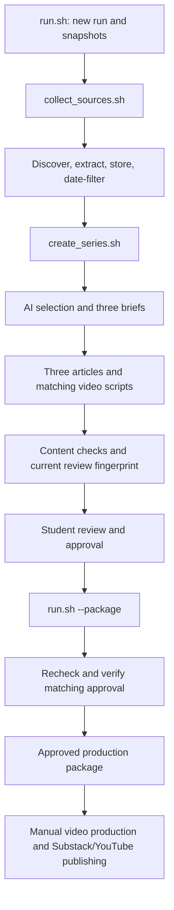

# Complete Pipeline Entry and Production Handoff

All 16 required Bash entry points are implemented. `run.sh` coordinates the
collection and series workflows; substantive work stays in the owning
components. No dependency was added for this integration.

## Run from the Project Root

```bash
bash run.sh
```

The entry validates configuration, creates a unique UTC-dated run, snapshots
the public configuration and four prompts, initializes storage through
`data/store.sh`, collects sources, and builds the three article/script pairs.
It saves the summary last, including when a component fails, and prints that
summary JSON on stdout. Diagnostic messages go to stderr.

Required setup: the project's `.venv`, packages in `requirements.txt`, curl,
ffmpeg/ffprobe, Node.js for YouTube extraction, and `OPENAI_API_KEY` in the local
environment or ignored `.env`. The current machine uses a local-cache virtual
environment linked at `.venv`. See [COLLECTION.md](COLLECTION.md) and
[SELECTION.md](SELECTION.md) for installation, transport, credentials, costs,
and known source-access limitations. Never commit the credential value.



## Failure and Replay Behavior

Collection preserves partial results and its failures; it continues with usable
evidence where possible. The series stops at a failed stage, preserving receipts,
raw successful model responses, and any partial JSONL stream with a `pending`
suffix. It checks the assessment's `passed` field, not just the checker exit
code: a completed assessment can report blocking issues.

Each workflow and entry invocation records its own receipt without counting
component API fees twice. Identical stored evidence avoids new versions, and
identical same-run model requests reuse successful responses. A changed prompt,
policy, evidence set, date, or model changes the request fingerprint. Fix errors
explicitly; there is no automatic provider retry or silent weakening of checks.

To replay a series in an unapproved run:

```bash
bash workflows/create_series.sh runs/RUN_ID
bash reporting/summarize_run.sh runs/RUN_ID > runs/RUN_ID/summary.json
```

The series workflow refuses regeneration when an approval record exists, to
preserve reviewed content. Use a new run for regeneration or policy comparisons;
use the package mode for rechecking approved material. Existing dated snapshots
and prior receipts remain preserved.

## Student Approval and Packaging

Review the actual drafts and their source evidence. Complete the required sample
review of three accepted and three rejected/deferred items. Only the student
supplies `RUN_DIR/approval.json`, containing `review_id`, `decision`, `reviewer`,
`reviewed_at`, and `notes`. Use the current `review.json` ID and a real UTC review
timestamp. Record `revise` when corrections are needed, and `approve` only after
reviewing the actual material. The current [student approval](runs/20261014T234433Z-full-4bc4b0/approval.json) records a direct confirmation in conversation; it applies only to that review fingerprint.

```bash
bash run.sh --package runs/RUN_ID
```

This mode reruns content checks, verifies matching approval, and packages copies
of the approved articles, scripts, and per-piece source notes. It does not
recollect sources, call generation models, or change drafts/configuration.
The independently runnable `publishing/prepare_package.sh RUN_DIR` performs the
same fresh-input and approval checks even when called directly.

The package contains nine main assets, `manifest.json`, copied review/approval,
`MANUAL_STEPS.md`, and `publication_links.json`. Enter real Substack/YouTube URLs
after publishing. Repackaging preserves entered links and archives the previous
package under a unique backup name; it does not delete it. Copied content hashes
must match the reviewed source snapshot. A modified package or stale approval
cannot be reported as ready for production.

Summary states are `failed`, `awaiting_review`, and `ready_for_production`.
Passing mechanical checks do not prove credibility or independence. `complete_live_run`
requires live full-pipeline scope, completed collection/generation, current
checks, and minimum metadata coverage; scoped runs and fixtures do not count.
Metadata counts remain proxies, requiring substantive and independence review.
Recorded publication links are not proof that a video was rendered or published.

## Verification Recorded

```bash
.venv/bin/python tests/test_workflows.py
```

The isolated test runs real Bash orchestration, SQLite, filtering, review, and
packaging with explicitly fictional external collection/model stages. It checks
normal completion, summary on failure, completed-but-failed assessment, missing
and stale approval, positive fixture packaging, preserved publication links,
recoverable backups, tampered package rejection, and duplicate replay. Simulated
approval applies only to fictional material in a temporary test workspace.
There are no paid requests or real student approvals in that test.

The [real retained-draft entry check](runs/20261014T212823Z-content-3b48fa/integration_check.json)
invoked package mode and correctly stopped for missing student approval.
The six drafts and configuration/prompt snapshots remained unchanged. Current
checks pass, and the [summary](runs/20261014T212823Z-content-3b48fa/summary.json)
reports `awaiting_review`. No production package or additional model request
was created by that check.

Neither this fixture test nor the retained-draft packaging check replaces the
required live executions. Two complete live lifecycles on October 14 and October 15,
including original failures and documented stage recovery, are recorded in
[LIVE_RUNS.md](LIVE_RUNS.md). The October 14 series is approved, packaged, and
published; YouTube external-link verification remains pending. The October 15
drafts pass current checks and await new student review. The recorded technical
demonstration is included at [submission/technical-demo/technical-demo.mp4](submission/technical-demo/technical-demo.mp4). See [SUBMISSION.md](SUBMISSION.md) for the current handoff state.
