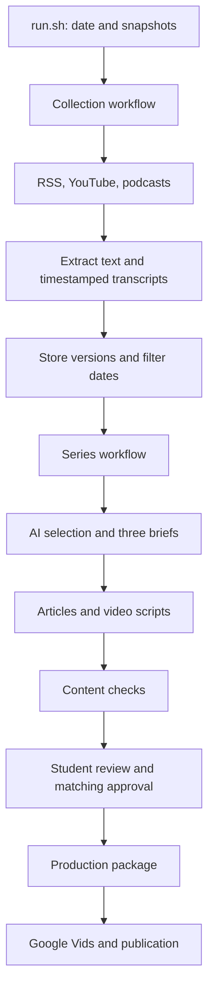

# AI Frontier Watch

A repeatable AI news and analysis pipeline for MIT 1.125 Problem Set 4. It collects recent written articles, YouTube videos, and podcasts, then produces three connected article/video-script pairs with traceable sources.

The editorial priority is **substantive novelty over popularity**. The audience is readers interested in technology and AI; no programming or machine-learning background is assumed.

## Published Series

| Piece | Article | Video |
| --- | --- | --- |
| A Release Is Only as Useful as Its Route to Users | [Substack](https://tongzhou2.substack.com/p/a-release-is-only-as-useful-as-its) | [YouTube](https://youtu.be/sBxcOquNgms) |
| The Right Test Depends on the Job | [Substack](https://tongzhou2.substack.com/p/the-right-test-depends-on-the-job) | [YouTube](https://youtu.be/8kLHG2qRHPQ) |
| The Hard Part Starts After the Model Works | [Substack](https://tongzhou2.substack.com/p/the-hard-part-starts-after-the-model) | [YouTube](https://youtu.be/NURPMsMGosY) |

**Technical demonstration:** [technical-demo.mp4](submission/technical-demo/technical-demo.mp4), approximately **4 minutes 12 seconds**. The video was exported from Photos with its current trim and saved as an H.264/AAC MP4. See [media verification](submission/technical-demo/verification.json) for measured duration and checks.

The October 14 series is published. A second real run on October 15 produced new drafts with passing mechanical checks; those drafts await their own student approval. YouTube external-link clickability remains unverified after the channel-verification prompt. Saved full article URLs and published article-to-video links are documented in the [publication record](runs/20261014T234433Z-full-4bc4b0/production/README.md).

## Start Here

- [Student submission](SUBMISSION.md): topic, published work, evidence, editorial review, and reflection.
- [Pipeline guide](PIPELINE.md): commands, architecture, recovery, approval, and packaging.
- [Two real live runs](LIVE_RUNS.md): measurements, differences, original failures, and recovery.
- [Original assignment](ASSIGNMENT.md) and [architecture contracts](ARCHITECTURE.md): retained course requirements.

## Setup

Tested with Python **3.12.1** and SQLite **3.43.1**. Install Python 3.12+, Bash, curl, FFmpeg/ffprobe, and Node.js 22+ on the machine running live collection. Python dependencies are pinned in [requirements.txt](requirements.txt): yt-dlp and its matching EJS package.

From the repository root:

```bash
python3 -m venv .venv
.venv/bin/pip install -r requirements.txt
cp .env.example .env
```

Set `OPENAI_API_KEY` in your local `.env` or environment. The key and local virtual environments are excluded from Git. Create your own environment after cloning; this machine's local-cache environment is not included.

The recorded editorial calls used `gpt-6-luna`; API transcription used `whisper-1` with timestamps. Provider settings and historical price assumptions are in [config/editorial.json](config/editorial.json) and [config/transcription.json](config/transcription.json). Live execution requires network and model access and can incur API charges. Reported fees are estimates, not invoices. Further setup and source-access limitations are in [COLLECTION.md](COLLECTION.md) and [SELECTION.md](SELECTION.md).

## Run

```bash
bash run.sh
```

This validates configuration, snapshots settings/prompts, collects and stores evidence, applies the 30-day window, selects material, generates three briefs and matching drafts, checks the content, and saves a summary. A normal draft run stops at `awaiting_review`.

After actual student review and an approval record matching the current `review_id`:

```bash
bash run.sh --package runs/RUN_ID
```

Replace `RUN_ID` with the run directory. Packaging rechecks the reviewed inputs and preserves approved content; it does not recollect sources or generate new drafts. Google Vids production and platform publication are manual handoffs. [PIPELINE.md](PIPELINE.md) explains stage replay and failure behavior.

## Architecture



All **16 required Bash entry points** are implemented. Workflows coordinate; each component owns its substantive work. JSON Lines carries records between components. Only `data/store.sh` accesses the persistent SQLite evidence index. Source text, transcripts, configuration snapshots, raw model responses, and stage receipts remain inspectable.

## Recorded Executions

| Complete live lifecycle | Current-run extraction | New / changed / unchanged | Eligible retained items | Time through collection-to-draft summary | Estimated provider fee |
| --- | --- | --- | --- | --- | --- |
| [October 14](runs/20261014T234433Z-full-4bc4b0/summary.json) | 14 | 0 / 1 / 13 | 19 | 736.56 s | $0.075230 |
| [October 15](runs/20261015T185032Z-full-71d5e6/summary.json) | 14 | 7 / 0 / 7 | 26 | 474.11 s | $0.070438 |

Both are real collection-to-draft lifecycles on different dates, with documented stage recovery. Original failed entries remain preserved. Earlier scoped runs and fictional offline tests do not count as these two executions. Newly stored material does not necessarily describe an event from that day. See [LIVE_RUNS.md](LIVE_RUNS.md) and the [second-run comparison](runs/20261015T185032Z-full-71d5e6/run_comparison.json).

## Verification

Run the offline checks from the project root:

```bash
.venv/bin/python tests/test_collection.py
.venv/bin/python tests/test_selection.py
.venv/bin/python tests/test_briefs.py
.venv/bin/python tests/test_drafts.py
.venv/bin/python tests/test_workflows.py
```

These exercise dates, duplicate/version handling, timestamp validation, selection constraints, exact evidence references, cached requests, claim binding, stale approval, and packaging. External collection/model stages are stubbed where appropriate; these checks make no paid requests or real approval decisions.

## Evidence and Repository Contents

- `collectors/`, `processing/`, `data/`, `editorial/`, `content/`, `review/`, `publishing/`, `reporting/`: component implementations.
- `config/` and `prompts/`: current topic, source list, policy, provider settings, and four English prompts.
- `data/assets/`: retained substantive source text, transcript segments, original pages, and successful transcription responses.
- `data/evidence/`: persistent versioned evidence index, accessed through the store interface.
- `runs/`: actual inputs, outputs, snapshots, failures, receipts, and approved publication package.
- `student_review/` and [STUDENT_REVIEW.md](STUDENT_REVIEW.md): version-scoped editorial notes.
- `submission/technical-demo/`: the recorded technical demonstration and media verification.
- `examples/`: explicitly fictional interface examples.
- `tests/`: offline checks.

Source audio in `data/media/`, local production narration/clips/previews, private credentials, and local environments are excluded from Git. For omitted source media, use the public `url`/`media_url` in retained item records and the collector/transcription commands in [COLLECTION.md](COLLECTION.md). The timestamped evidence needed for inspection remains included. Temporary recording guides and rehearsal scripts have been removed from the project.

Mechanical checks do not establish semantic accuracy, transcript fidelity, or independent corroboration. The pipeline records these limits and requires editorial judgment before publication.
